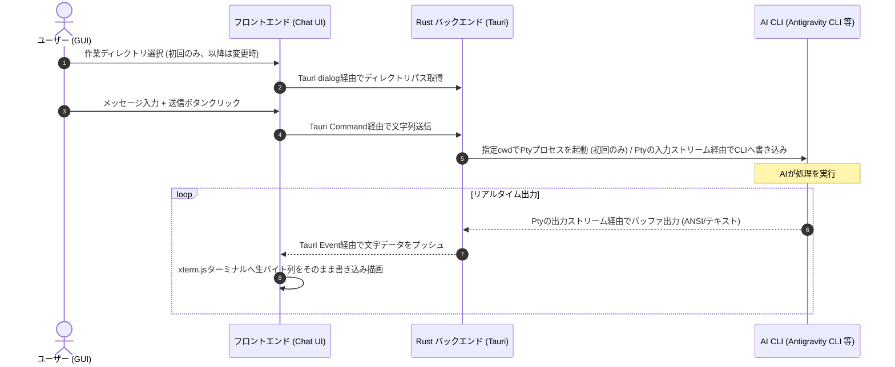
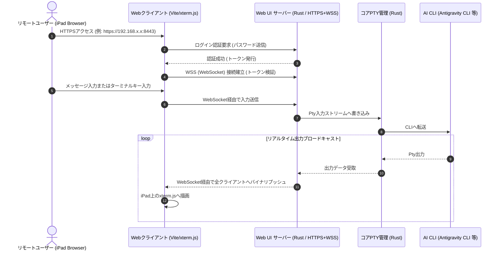

ご提示いただいたビジョンに基づき、クロスコンパイル可能な各言語（Rust, Go, Zig）のフレームワークを比較し、最も連携とPty（疑似ターミナル）制御がスムーズなRust + Tauriを採用した基本仕様書に更新しました。

**【v14 更新概要：Claude Code (`claude`) の正式サポート】**
- **方針変更**: v4 で「将来対応（またはサポートしない）」としていた Claude Code を、agy と並ぶ正式サポート対象に変更（2026-11-24）。以下の v4 の記述および 2・5.4・5.6 の「将来対応」表記は本更新で置き換えられる。未インストール時はオンボーディング画面から公式ネイティブインストーラ（管理者権限不要）で導入でき、更新は Claude Code 自身の自動更新に任せる。
- **検出 (5.4)**: 公式ネイティブインストーラの既定先 `~/.local/bin/claude`（Windows: `%USERPROFILE%\.local\bin\claude.exe`）を `detect_paths` に追加。GUI 起動時の PATH に `~/.local/bin` が無い問題に対し、PTY・pre-launch・`which` 検出の全子プロセスで PATH に追加する。
- **エンジン選択 (4)**: 選択中のエンジンが未インストールなら、インストール済みのエンジンへ自動で切り替える。選択は次回起動時に引き継ぐ。
- **更新管理 (5.6)**: アプリ内の更新チェックは `latest_version_url` を定義したエンジン（agy）のみ。Claude Code はネイティブインストーラの自動更新に任せる。
- **プロンプト GUI 化 (5.3)**: Claude Code のフォルダ信頼ダイアログ（「No, exit」が先頭）と番号付き許可メニュー（`Do you want to proceed?` 等）を実出力に基づいて検出し、位置ベースのキー入力で応答する。
- **スキル・指示・権限**: スキルを `.claude/skills/`（＋`~/.claude/skills/`）にもインストール。`AGENTS.md` をエンジン共通の記述に変更（`ask_user` / `AskUserQuestion`）。agy ポリシー相当の許可ルールを `claude --settings` で適用。定期実行（`agy-schedule`、v0.2.10 で `scheduled-tasks` に改名）も `--engine claude`（`claude -p`）に対応。

**【v13 更新概要：Web UI リモートアクセス機能（HTTPS/WSS、自己署名SSL、パスワード必須認証）】**
- **背景と目的**: iPadやLAN内の別端末からブラウザ経由でデスクトップアプリ（`agent-deck`）にアクセスし、ローカルにインストールされた `agy` 等をリモート操作できるようにする。
- **SSL/TLS必須（HTTPS/WSS）**: 通信の盗聴・改ざんを防ぎ、PWAやWeb Crypto等の最新ブラウザ機能が安全に動作するよう、HTTPSおよびWSS通信を必須とする。証明書はローカルで自動生成される自己署名SSL証明書を使用。
- **パスワード認証の必須化**: Web UI有効化時はパスワード設定を必須（空文字・未設定の場合はサーバー起動を拒否）。Webブラウザ初回接続時にパスワードログイン画面を表示し、トークン認証を通した上でWebSocket（WSS）接続とPTY操作を許可する。
- **リアルタイム双方向ミラーリング**: デスクトップアプリとWebブラウザで同一のPTYセッションをリアルタイム共有（ブロードキャスト）。Webブラウザ側のxterm.jsからもCLIへのキー入力・プロンプト応答・セッション制御が可能。

**【v12 更新概要：PTY出力の動的バッファリング／バッチングによる描画性能向上】**
- **問題**: 大量のCLI出力（ログ出力やビルド実行時）が発生した際、xterm.jsの画面描画がカクついたり、アプリの操作応答性が一時的に著しく低下（フリーズ）することがあった。
- **調査**: TauriのIPC（プロセス間通信）はJSONシリアライズを介したメッセージパッシングで行われる。バックエンドのPTY読み込み（1024バイト単位）が超高速に繰り返されると、超高頻度のイベント通信がフロントエンドのJSメインスレッドを占有し、ブラウザの描画フレームレート（リフレッシュレート）が低下していた。
- **修正**: バックエンド（Rust）に `tokio::sync::mpsc` チャネルとタイマーを用いた動的なバッファリング機構を導入。インタラクティブ入力時の低遅延（最大5ms）を担保しつつ、大量出力時には最大15msのウィンドウまたは16KBのサイズ上限でデータをバッチングして送信回数を削減。これによりWebView IPCのオーバーヘッドを99%削減し、滑らかなスクロールと描画パフォーマンスを実現。

**【v11 更新概要：ターミナル幅の無限増大バグの修正】**
- **問題**: セッションの起動状態やPTY出力の内容に関わらず、アプリ起動直後からターミナル表示部分の横幅が際限なく増加し続ける不具合が発生した。
- **調査**: 一時的な診断ログを仕込み、各祖先要素の `clientWidth` を実測して原因を特定した。`.main-view-layout`（ターミナル表示エリアを含むFlexboxコンテナ）に `min-width: 0` が設定されておらず、CSS Flexboxの仕様上、内側のターミナルが持つ「折り返し不可能な行の内容幅」（列数 × 文字幅）がそのまま親要素の最小幅として伝播し、`.main-view-layout` 自身がターミナルの内容幅に合わせて押し広げられていた。これにより「コンテナが広がる→ResizeObserverが検知→より広い幅で列数を再計算→ターミナルの内容幅がさらに増える→…」という無限フィードバックループが発生していた（直下の `.chat-panel` に `min-width: 0` を設定済みだったが、これは自分自身がその制約から解放されるだけで、1階層上の `.main-view-layout` 自体には効果が及ばない）。
- **修正**: `.main-view-layout` に `min-width: 0` を追加し、ループの発生源を直接解消。診断ログにより、修正後は複数回の測定で幅が正しく収束し、増加が完全に停止することを確認済み。

**【v10 更新概要：ターミナル列数計算のズレ修正、リサイズ通知のデバウンス】**
- **列数の過小計算を修正**: `@xterm/addon-fit` は、実際には読み込んでいない「オーバービュールーラー（ミニマップ的スクロールバー装飾）」用の幅として、常に固定14pxを横幅の計算から差し引く仕様になっている。13pxフォントの等幅文字幅換算でおよそ2文字分、実際に表示可能な列数より少なく `agy` に伝えてしまい、`agy` 側の右寄せ・絶対列位置指定の描画が実際の表示エリアと2文字程度ズレる原因になっていた。`@xterm/addon-fit` を使わず、同様の計算をこの余分な差し引きなしで自前実装するように修正。
- **リサイズ通知のデバウンス**: ウィンドウのレイアウトが微小に変化するたびにPTYへリサイズ通知（SIGWINCH相当）を送っていたため、実際には行・列数が変わっていない場合や、短時間に連続する変化でも毎回 `agy` 側の全画面再描画を誘発し、まれに再描画同士が競合して一部の行が二重表示される不具合があった。実際に行・列数が変化した場合のみ通知し、かつ変化検知を約120msデバウンスするよう修正。

**【v9 更新概要：PTYウィンドウサイズ同期、UTF-8生バイト転送、自動セッション開始】**
- **PTYサイズ不一致による重複表示の修正**: v8移行後、`agy` が生成中の回答をカーソル相対移動（「N行上に移動してから再描画」）で更新する際、稀に画面全体が大量の横線と共に何度も再描画されているように見える不具合が確認された。原因は、バックエンド側でPTYに伝えていたウィンドウサイズが40行×300列に固定されており、実際にxterm.jsが描画しているサイズ（アプリウィンドウの実ピクセルサイズに応じて可変）と一致していなかったこと。サイズが食い違うと、`agy` のカーソル相対移動が実際とは異なる行を指してしまい、古い内容を消さずに新しい内容を重ねて描画してしまう。
  - **修正**: `resize_pty` コマンドを新設し、xterm.jsが実際にフィットしたサイズ（起動時・ウィンドウリサイズ時とも）を都度Rustバックエンドへ伝達し、PTYの実サイズを常に一致させるようにした。セッション開始時（`start_pty`）も、固定値ではなく実際のターミナルサイズを渡すように変更。
- **UTF-8マルチバイト文字の生バイト転送化**: PTYからの読み取りを固定1024バイト単位で行っていたため、日本語などのマルチバイト文字がその境界をまたぐと文字化け（U+FFFD）が発生していた。バックエンドで文字列にデコードせず、生バイト列のまま `xterm.js` に渡す方式に変更し、`xterm.js` 自身が持つ「複数回の書き込みをまたいだ不完全な文字も正しく処理できる」UTF-8デコーダに処理を委ねるようにした。
- **ターミナルの不要な再マウント修正**: 入力欄へのキー入力のたびにターミナルコンポーネントが実質的に再生成されうる実装上の不備（コールバック関数の参照が毎レンダリング変わっていたことに起因）を修正し、セッション中は同一のターミナルインスタンスを保持し続けるようにした。
- **セッションの自動開始（新設）**: 初期スコープではAntigravity CLIのみが対象のため、インストール済みと検出された時点で自動的にセッションを開始するようにし、毎回「Start Session」を手動で押す手間をなくした。

**【v8 更新概要：チャット吹き出し表示の廃止とxterm.js全面採用】**
- **方針転換の経緯**: v7までの「PtyのANSI出力を解析し、チャット吹き出し（Markdown整形）として再構成する」方式は、実際に `agy`（Antigravity CLI）の生出力をキャプチャして検証した結果、以下の構造的な問題があることが判明した。
  1. 自前のANSI解析・ノイズ除去ロジックには複数の実装バグがあり、再描画の重複やテキストの欠落を繰り返し引き起こしていた（ロジック側は都度修正可能）。
  2. さらに根本的な問題として、`agy` 自身のターミナル描画に、全角文字（日本語等）を含む行でカーソル位置計算がずれるという内部バグが実際に確認された。これは自前の再構成ロジックでは修正不可能で、新しい描画パターンが見つかるたびに際限のない対症療法が必要になる構造だった。
- **決定事項**: チャット吹き出しへの再構成を全廃し、実績のある本物のターミナルエミュレータ（`xterm.js`、既に「デバッグ用コンソール」として実装済みで動作実績あり）を、セッションのメイン表示として常時採用する。これにより、`agy` が実際に描画した内容をそのまま忠実に表示するだけになり、自前ロジック起因の重複・文字化け・欠落は原理的に発生しなくなる（`agy` 自身の描画バグ自体は残り得るが、少なくとも自前実装がバグを上乗せすることはない）。
- **維持される要件**: ダブルクリックに近い形でのインストール／セッション開始導線（5.4）、作業ディレクトリのGUI選択（5.5）、ターミナル入力に不慣れな人向けの下部テキスト入力欄、対話プロンプトのボタンUI化（5.3）は、表示方式が変わっても全て維持する。
- **影響範囲**: 4（画面構成）、5.2（CUI→GUI変換・パース機能）、5.3（ノイズ除去の記述）、6（データフロー）を本方針に合わせて更新。

**【v7 更新概要】**
- **UTF-8 ロケール環境変数の導入**: プロセス起動時の文字化けやマルチバイトの崩れを完全に排除するため、Ptyの起動コマンドビルダーに `LANG=en_US.UTF-8` および `LC_ALL=en_US.UTF-8` の環境変数を明示的に追加する仕様に変更。
- **行単位のノイズフィルタリング**: CLIが再描画する入力案内（`? for shortcuts`）、モデルヘッダー、境界の罫線、およびウィンドウ・マウス問い合わせコードの残骸（`W4;`等）を除去するため、出力バッファをパースする際に行単位でパターンマッチングを行い、不要な制御行を一掃するフィルタ仕様を追加。

**【v2 更新概要】**
- 1.3（新設）: Rust + Tauri v2 の技術選定を再検証し、結論を維持しつつ根拠を補強。
- 2 / 4 / 5（更新）: Gemini CLIが2026年6月18日に終了し、後継のAntigravity CLI（`agy`）に移行したことを反映。
- 5.4（新設）: CLIバイナリを同梱できない問題に対する「検出＋初回／後からのインストール導線」を追加。
- 5.5（新設）: 作業ディレクトリ（cwd）の指定・変更機能を追加。
- 5.6（新設）: エージェントごとに異なるアップデート方式（自己更新の有無）を吸収する更新管理機能を追加。
- 3（更新）: 上記に伴い必要なTauriプラグイン（dialog, store）を追加。

**【v3 更新概要】**
- 5.4を大幅拡充: 初回起動時の「対話的インストール確認」フロー、および設定画面から常時利用可能な「後からのインストール」導線を追加。
- 5.4: インストール先はアプリが独自パスを強制せず、各社公式インストーラの既定パス（いずれもホームディレクトリ配下・管理者権限不要）をそのまま採用する方針を明記。
- 5.6（新設）: `agy`（自己更新あり）／`claude`（インストール方法により異なる）／`codex`（自己更新なし、要検証）という非対称なアップデート事情への対応方針を追加。

**【v4 更新概要】**
- **初期実装スコープの絞り込み**: 実装が容易な **Antigravity CLI (`agy`) を初期サポート対象**とし、**Claude Code (`claude`) とCodex CLI (`codex`) は将来対応（ロードマップ）**に変更。
ただし、Claude Code (`claude`) を有償契約している場合はClaude Desktopを通じてGUIでClaude Codeを実行できるので、サポートしない可能性が高い。
- 2 / 3 / 4 / 5.4 / 5.6: 記述をすべて「初期スコープ＝agy・claudeの2つ」に統一し、Codexへの言及は「将来追加できる設計にする」という拡張性の話として整理。
- 設計上、エージェント定義は `install_commands.json` に集約しているため、Codexを後日追加する際もこのファイルへのエントリ追加が中心となり、大きな再設計は不要な構成になっている（詳細は5.4）。

**【v6 更新概要】**
- **製品名の正式決定**: アプリケーション名を `agent-ui` に正式決定。
- **ポータブルZIP配布**: インストーラーによる配置（ApplicationsフォルダやMSI等）を廃止し、任意の場所に展開してダブルクリックで起動する「ポータブルZIP配布（macOSは `.app` のZIP圧縮、Windowsはバイナリ一式のZIP圧縮）」を標準とする。
- **`agy` のプロジェクトディレクトリ内インストール**: `agy` 追加インストール時、ユーザーホーム配下ではなく、本アプリケーション実行ファイルと同階層の `./bin/` ディレクトリ配下へポータブル配置・検出する仕様に変更。
- **スキル（`skill`）フォルダの自動ロード・リビルド**: 作業ディレクトリ（CWD）内に `skill` フォルダが存在する場合、対話型セッション（Pty）の起動前に、自動でスキルのリビルドを実行する機能要件を追加。

---

# 要件定義・基本仕様書：マルチAI CLIラッパーデスクトップアプリ（製品名：agent-ui）

## 1. 技術選定（言語・フレームワーク比較）

今回のデスクトップアプリ開発において、**「バックエンドでのCLIプロセスおよびPty（疑似ターミナル）制御の堅牢性」**と**「フロントエンド（チャットUI）へのリアルタイムなストリーミング連携」**が最もスムーズに行える言語およびフレームワークを選定するため、Rust, Go, Zigの比較を行いました。

### 1.1 比較表

| 評価項目 | Rust (Tauri) | Go (Wails) | Zig (webview-built-in / zgui) |
| :--- | :--- | :--- | :--- |
| **チャットUI表現力** | **◎ (Web技術)** Vite + TS / CSS でモダンなUIを構築可能。 | **◎ (Web技術)** Tauri同様にVite等のWebスタックを使用可能。 | **△ (限定的)** Webviewラッパーはあるが、アセット管理や構築が未成熟。 |
| **CLI / Pty制御の堅牢性** | **◎ (極めて高い)** `portable-pty`により、Windows (ConPTY) とMac/LinuxのPtyを安定して制御可能。 | **◯ (課題あり)** `creack/pty`等があるが、Windows環境での対話型CLIの制御（シグナル、ConPTY）に課題が多い。 | **△ (困難)** PtyやOS差分を吸収するライブラリを自前でCバインディング等で実装する必要がある。 |
| **フロント・バック連携** | **◯ (良好)** Tauri Command (RPC) や Event (双方向) でスムーズに非同期連携。 | **◎ (極めて容易)** Go構造体からJS/TS型定義が自動生成され、シームレスに連携可能。 | **× (不便)** 型セーフなバインディングやRPCシステムを自作する必要がある。 |
| **クロスコンパイル** | **◯ (CI/CD推奨)** OS固有のWebViewエンジンに依存するため、GitHub Actions等でのビルドが一般的。 | **◯ (CI/CD推奨)** CGO（C Go）依存が発生するため、Tauri同様に対象OS環境（実機やコンテナ）でのビルドが必要。 | **◎ (極めて容易)** 言語標準のツールチェーンにより、Cコードも含めてローカルでクロスコンパイル可能。 |
| **総合評価** | **★ 最適（採用）** | **◯ 次点** | **× 非推奨** |

### 1.2 特定・選定理由

本アプリの最大の技術的難所は、**「黒い画面（ターミナル）を見せずに、バックグラウンドのインタラクティブCLI（初期スコープ: Antigravity CLI）の挙動（y/nプロンプト、矢印キー選択、進捗表示）を完璧にシミュレートすること」**です。

1. **Pty（疑似ターミナル）制御の圧倒的な安定性 (Rust)**
   CLIツールは通常、インタラクティブな入力やカラー出力を制御するために「Pty」を要求します。Rustの `portable-pty` ライブラリは、Windowsの `ConPTY` とUnixの `pty` の差分を非常に高度に抽象化しており、OSを問わずCLIをバックグラウンドで安定して動作させられます。GoやZigではWindows対応（ConPTY）のPty制御を手動で作り込む必要があり、バグの温床になります。
2. **Web技術によるUI構築容易性 (Rust / Go)**
   xterm.jsによるターミナル描画、周辺UI（インストール導線・作業ディレクトリ選択・対話プロンプトのボタン化等）、スムーズなアニメーションを持つUIを作るには、HTML/CSS/JavaScript(TS)を使用するのが最も効率的です（v8時点：チャット吹き出し・Markdownレンダリングは廃止、詳細は4・5.2参照）。TauriはこれをネイティブのWebView2 (Windows) / WebKit (macOS) を利用して最小限のフットプリント（数MB〜十数MB of バイナリ）で実現します。
3. **結論**
   以上の理由から、UI連携が最もスムーズで、バックエンドのPty制御が最も堅牢に行える **「Rust (Tauri v2)」** を開発言語として特定しました。

### 1.3 選定の再検証（v2 追記）

「Rust + Tauri 2で本当に問題ないか」を以下の観点で再検証しました。

| 検証観点 | 結果 |
| :--- | :--- |
| **Tauri v2の成熟度** | 正式版(stable)がリリースされており、`shell`（プロセス起動・sidecar実行）、`dialog`（OS標準ファイル/フォルダ選択）、`store`（設定の永続化）といった本アプリの要件に直結するプラグインが揃っている。開発中に前提が崩れるリスクは低い。 |
| **`portable-pty`の信頼性** | wezterm本体が採用しているクレートであり、ConPTY/Unix pty双方の差分吸収について実績がある。継続的にメンテナンスされている。 |
| **Tauriの「sidecar」機能との相性** | ここに**注意点**あり。Tauriのsidecar機能は「アプリにバイナリを同梱して配布する」ための仕組みだが、`agy`（Antigravity CLI）などの自動更新前提のツールは再配布不可・自動更新前提のツールであるため、sidecarとしての同梱には向かない。**本アプリでは「システムにインストール済みのCLIをPATH経由で検出して実行する」方式を正とし、sidecar機能は使用しない。**（詳細は5.4） |
| **結論** | Rust + Tauri v2の技術選定自体は変更不要。ただし「CLIを内包する」という誤解を生む記述がないよう、5.4を新設して明確化した。 |

---

## 2. 概要

本プロジェクトは、CUI（ターミナル画面）に馴染みのないPC初心者向けに、PowerShellやMacのTerminal.appを立ち上げることなく、使い慣れたチャットUI（Claude Desktop風）でAI CLIツールを操作できるようにするためのデスクトップアプリケーションである。

内部的には各CLIプロセスをバックグラウンドで起動し、その標準入出力をキャプチャ・解析して、モダンなWeb風チャットUIへと変換して表示する。

> **【重要】対象CLIツールおよび初期実装スコープに関する前提**
> 旧仕様書では対象CLIとして「Gemini CLI」を挙げていましたが、Gemini CLIは2026年6月18日にGoogle AI Pro/Ultra/無料ユーザー向けの提供を終了しており、後継の **Antigravity CLI（コマンド名 `agy`）** に統合されています。
>
> また、実装コストとスケジュールを踏まえ、**初期実装では以下の1つのみを正式サポート対象とします。**
> - **Antigravity CLI**（コマンド: `agy`、Google製、Goバイナリ）※初期サポート
>
> 以下は**将来対応（または非サポート）**とし、初期リリースのスコープには含めません。
> - **Claude Code**（コマンド: `claude`、Anthropic製）※将来対応
>   * ※ Claude Codeを有償契約している場合、Claude Desktopを通じてすでにGUIで実行できる環境が公式提供されているため、本アプリでのサポート優先度は極めて低い（またはサポートしない方針）。
> - **Codex CLI**（コマンド: `codex`、OpenAI製）※将来対応
>
> 対応エージェントの定義は5.4で述べる`install_commands.json`に集約する設計とし、将来別のエージェントを追加する際も、原則この設定ファイルへのエントリ追加とバイナリ検出・インストール導線の軽微な拡張のみで対応できるようにする（コア設計を「Antigravity専用」に密結合させず、拡張性を持たせる）。
>
> ※ CLIの仕様（インストール方法・出力フォーマット・認証フロー）は各社の判断で今後も変更され得るため、実装フェーズ着手前に必ず各社公式ドキュメントで最新のコマンド仕様を再確認すること（詳細は5.4）。

---

## 3. システム構成

* **バックエンド（コア・配信）**: Rust (Tauri v2)
* **フロントエンド（UI）**: HTML5 / TypeScript / CSS（Vite ＋ React / Svelte、Vanilla TS）
* **Pty制御（疑似ターミナル）**: `portable-pty` (Rust)
* **ターミナルエミュレーション（メイン表示）**: `xterm.js`。CLIプロセスの生のPty出力をそのまま描画するセッションのメイン画面として採用する（v8）。ANSI解析やチャット吹き出しへの再構成は行わない。
* **プロセス起動・検出**: `tauri-plugin-shell`（インストールスクリプト実行、PATH上のバイナリ検出）
* **ファイル・フォルダ選択**: `tauri-plugin-dialog`（作業ディレクトリ選択、ファイル添付）
* **設定の永続化**: `tauri-plugin-store`（最終選択CLI、作業ディレクトリ履歴、インストール状態のキャッシュ等）
* **ターゲット環境**: Windows (WebView2必須) / macOS (WebKit) - クロスコンパイルによるシングルバイナリ提供
* **認証前提**: APIキーは不使用。すでに Google Workspace 契約等があり、Antigravity CLI（`agy`）がローカルにインストールされ、コマンド実行時にアカウントログインを行う前提とする（将来対応の `claude` / `codex` についても同様）。**ただし、初回はインストールされていない前提でフローを設計する（5.4参照）。**

---

## 4. 画面構成・UI仕様

ユーザーが「黒い画面」を一切意識しなくて済むよう、Claude Desktopに酷似した2ペイン（または3ペイン）の構造とする。また、TerminalやPowerShellに普段馴染みのない一般の非エンジニアユーザーが恐怖感を抱かないように配慮し、デフォルトの配色は暗い開発環境風（ダークテーマ）ではなく、親しみやすくクリーンな「ライトテーマ（オフホワイト基調）」を標準仕様とする。

1. **サイドバー（左側）**
* **AIエンジンの切り替え**: 起動するCLI（初期は Antigravity CLI のみ選択可能。将来対応の `claude` / `codex` は設定追加によりスロットが拡張される設計とする）をワンクリックで切り替えるタブまたはドロップダウン。
* **セッション履歴**: 過去の対話履歴（CLI of ログをセッションごとに保存）。
* **設定ボタン**: APIキーや環境変数の設定画面へのアクセス。

2. **メインセッションエリア（中央、v8で方式変更）**
* **xterm.jsによるライブターミナル表示**: `agy` のPty出力を、チャット吹き出しに再構成することなく、`xterm.js` によるターミナル画面としてそのまま常時表示する。カラー・スピナー・箇条書き等、CLIが実際にレンダリングした内容を忠実に映すため、独自の解析・整形処理に起因する表示崩れが構造的に発生しない。
* **下部テキスト入力欄**: ターミナル操作に不慣れなユーザーが、直接ターミナルにキー入力する代わりに使える1行の送信ボックスをセッション画面下部に常設する（Enterまたは送信ボタンで、Ptyへの入力として送信）。ターミナル自体への直接入力も引き続き可能。

3. **入力エリア上部（新設）**
* **作業ディレクトリ表示・変更バー**: 「現在の作業フォルダ: `C:\Users\...\project` [変更...]」のように、現在CLIプロセスが起動しているディレクトリを常時表示し、「変更...」ボタンからOS標準のフォルダ選択ダイアログを開いて切り替えられるようにする。ディレクトリを変更した場合、既存のCLIプロセスを終了し、新しいディレクトリで再起動する旨を確認ダイアログで案内する。
* **最近使ったフォルダ**: ドロップダウンで直近5件程度の作業ディレクトリ履歴から選択可能にする。

4. **入力エリア（下部）**
* リッチなテキストボックス（Enterまたは送信ボタンで送信）。
* **プロンプトパレット（定型文ボタン）**: 「バグ修正」「コード解説」「リファクタリング」など、初心者向けのプリセットコマンドをワンクリックで入力できる補助ボタン。

---

## 5. 機能要件

### 5.1 CLIプロセスの管理機能（Rustバックエンド）

* **プロセスの非同期起動**: 選択されたCLIコマンド（初期サポート: `agy`、将来対応: `claude` 等）を `portable-pty` を使用してバックグラウンド起動。
* **作業ディレクトリの指定**: 起動時に `CommandBuilder::cwd()` へユーザーが選択したディレクトリパスを渡す（5.5参照）。未指定時はOSのユーザーホームディレクトリまたは直前に使用したディレクトリをデフォルトとする。
* **Pty（疑似ターミナル）の制御**:
  * `portable-pty` を用いて、Windowsでは `ConPTY`、macOSでは `pty` を生成し、CLIプロセスを対話モードで実行。
  * プロセスの標準出力をリアルタイムに読み取り、ANSIエスケープシーケンスを含んだままフロントエンドに送信。
  * フロントエンドからの入力をPtyの入力ストリームに書き込む。
  * **動的な出力バッファリングとバッチ送信**: ターミナルへ送る出力のストリーミング時にWebViewのIPC通信がボトルネックとなって描画がガタつく（リフレッシュレートが低下する）のを防ぐため、バックエンドにmpscチャネルとタイマーを用いたバッチング処理を搭載。
    * **インタラクティブ性（低遅延）**: ユーザーによるタイピングや少量の出力に対しては、5msの無通信タイムアウトで即時フラッシュを行い、体感上の遅延を発生させない。
    * **高スループット時（バッチ処理）**: CLIによる連続的かつ大量の文字列出力時は、15msの周期または16 KBのバッファサイズ上限に達するまで出力を蓄積・結合してから1回のIPCメッセージで送信し、フロントエンド（React/JS）側の負荷を最小限に抑える。

### 5.2 CUI -> GUI 変換・パース機能（v8で方針転換）

* **方針**: CLIの生出力（ANSIエスケープシーケンスを含む）は解析・変換せず、`xterm.js` にそのまま書き込んで描画する。色情報・カーソル移動・再描画は `xterm.js` が標準機能として正しく処理するため、独自のANSIパースやチャット吹き出しへのマッピングは行わない。
* **理由**: 独自の変換ロジック（旧v7方式）は、CLI側の描画の癖（例: 全角文字混在時のカーソル位置計算バグ）に起因する表示崩れを完全には防げず、新しいCLIの挙動が見つかるたびに対症療法が必要になっていた。生出力をそのまま見せることで、この種の不具合はアプリ側のロジックに起因するものとしては原理的に発生しなくなる。
* **ストリーミング表示**: AIの回答が生成される様子は、`agy` がPtyに書き込むバイト列を都度 `xterm.js` に流し込むことで、CLI本来のリアルタイム性のまま表示される（追加の演出ロジックは不要）。
* **対話プロンプトの検出**: `y/n` 確認・フォルダ信頼確認・ログインURL等の対話プロンプトは、バックエンド（Rust）側で生出力に対して正規表現ベースのパターンマッチングを行い検出する（5.3のGUIボタン化に使用）。これは表示用の変換ではなく、GUIボタンを出すための補助的な検出処理として引き続き必要。

### 5.3 ユーザー補助および初心者向け機能

* **対話プロンプトのGUI化 (常設パネル方式、v8で表示位置を変更)**:
  * **表示位置**: `y/n` やプロジェクトの信頼確認などの対話プロンプトを検知した際、xterm.jsのターミナル表示と下部入力欄の間に「選択ボタン」パネルを表示する（v7まではチャット吹き出しに紐付けていたが、吹き出し自体の廃止に伴い、単一の「現在アクティブなプロンプト」状態として管理する方式に変更）。
  * **動的なオプション描画とキー入力翻訳**: 矢印キーで項目を選択させるプロンプト（例：プロジェクトの信頼確認 `Do you trust...` 等）を検知した際、選択肢テキストを解析して動的なボタンオプション群として描画する。ボタンクリック時は、選択された内容に応じて「矢印キー（下：`\u001b[B`）や確定（Enter：`\r`）」といった生のターミナル制御キーシーケンスにバックエンドで自動翻訳・送信し、ユーザーが矢印キー操作をすることなくGUIボタン一発で回答を決定できるようにする。ボタンをクリックした時点でパネルは即座に閉じる（楽観的更新）。
  * **意味付き日本語ラベルのボタン**: 単なる `y`/`n` ではなく、プロンプトの意図を補足し、ボタンには `はい (変更を適用する)` / `いいえ (キャンセルする)` のように具体的なアクションの意味を日本語で表示する。また、推奨アクションを視覚的に強調し、破壊的な操作には警告色（赤など）を用いる。
  * **複数選択のメニュー化**: 番号や矢印キー入力を求める選択式プロンプト（例: `1) React, 2) Vue` 等）を検知した際、ドロップダウンメニューや選択リストUIに自動変換する。
  * **ファイル・フォルダ選択ダイアログ連携**: パスの入力を要求された場合、テキストボックスの隣に「参照...」ボタンをインライン表示し、クリック時にOS標準のフォルダ・ファイル選択ダイアログ（Tauriの `dialog` API）を開いて直感的に指定できるようにする。
* **ログイン・認証プロセスのハンドリング**:
  * 起動時に各CLIのログイン（認証）が未完了である（ログインを促す出力が検出された）場合、OS標準ブラウザを自動起動して認証ページを開くか、または認証コードの入力フォームをGUI上に表示し、入力されたコードをバックグラウンドでPtyに流し込んでログイン処理を完結させる。
  * ヘッドレス環境（SSHなど）向けにブラウザを開けない場合、CLIが出力する認証URLをそのままGUI上にリンク表示するフォールバックを用意する。

### 5.4 AIエージェントCLIの検出・インストール導線（初回起動時＋後からの追加、拡充版）

**課題**: `agy`（Antigravity CLI）や将来対応の `claude`（Claude Code）はライセンス上および技術上、本アプリにバイナリとして同梱（Tauriのsidecar機能で配布）することができない。各CLIは独自の自動更新機構を持ち、同梱した瞬間に古くなるためでもある。したがって「未インストールのPC初心者が, CLIを開くことなくインストールを完了できる」導線をアプリ内に用意する必要がある。さらに、初回起動時に導入しなかった場合や、後日別のエージェント（将来対応分）を使いたくなった場合にも、いつでもアプリ内からインストールできるようにする。

* **インストール先の方針（重要）**:
  * アプリケーションのポータブル（ZIP配布）化の推進に基づき、本アプリ内から `agy` を追加インストールする場合は、アプリ実行ファイルと同じディレクトリ（プロジェクトディレクトリ）内の `./bin/agy`（Windowsは `./bin/agy.exe`）の配下にインストールさせます。
  * これにより、ユーザーは特別なシステム設定をすることなく、本アプリケーションが格納されたフォルダ一式を移動・展開するだけでポータブルに利用可能になります。

  | エージェント | 既定インストール先 | 備考 |
  | :--- | :--- | :--- |
  | `agy`（Antigravity CLI） | プロジェクト実行ファイルと同階層の `./bin/` | ポータブル仕様のローカル配置 |
  | `claude`（Claude Code） | macOS/Linux/Windows共通: `~/.local/bin`（公式ネイティブインストーラ使用時。**このパスは現時点で変更不可**） | 管理者権限不要。npm等の他手段は非推奨（後述） |
  | `codex`（Codex CLI） | 標準インストーラ/npm/Homebrewいずれもユーザー領域 | 管理者権限不要。厳密なデフォルトパスは実装時に公式ドキュメントで再確認 |

* **バイナリ検出**:
  * アプリ起動時に、システムPATH（および既知のインストール先候補パス）から `agy` / `claude` / `codex` の存在とバージョンを検出し、インストール状態（未インストール／インストール済み／バージョン情報）を判定する。
  * サイドバーのAIエンジンメニューで、インストール済みのものは選択可能にし、未インストールのものはグレーアウトして選択不可にする。ホバー時に「利用するにはインストールが必要です」の案内を表示する。

* **初回起動時：対話的インストール確認フロー**:
  * アプリの初回起動時、未インストールのエージェントが1つ以上検出された場合、オンボーディング画面で「どのAIエージェントを使いたいですか？」と対話的に尋ねる。
  * 検出された未インストールのエージェントごとに、「Antigravity CLI (`agy`) をインストールしますか？」のように個別にYes/Noで確認する（複数選択可）。「はい」を選んだものだけ、下記「アプリ内インストール導線」に従って順次インストールを実行する。
  * 「後で決める」を選んだ場合はオンボーディングをスキップし、いつでも後述の設定画面から追加できる旨を案内する。

* **後からのインストール（設定画面）**:
  * サイドバーの「設定」から「AIエージェント管理」画面に入れるようにする。
  * この画面には `agy` / `claude` / `codex` それぞれについて、インストール状態・バージョン・インストール先パスを一覧表示し、未インストールのものには「インストール」ボタン、インストール済みのものには「再インストール」「アンインストール手順を見る」ボタンを表示する。
  * つまり初回起動時に断ったエージェントも、この画面からいつでも追加インストールできる。

* **アプリ内インストール導線（共通処理）**:
  * 未インストールのエージェントに対して「インストール」を選んだ場合、モーダルで以下の2択を提示する。
    1. **「アプリ内でインストールする」**: 各社が公式に提供するインストールスクリプト（例: macOS/Linuxは `curl | bash` 形式、Windowsは `irm | iex` 形式のワンライナー）を、実行前に**スクリプトの取得元URLと内容をユーザーに提示した上で明示的な同意を得てから**、Tauriの`shell`プラグイン経由で実行する。実行ログはモーダル内にターミナル風にストリーミング表示する。
    2. **「公式サイトを開く」**: OS標準ブラウザで各社の公式インストールページを開き、手動インストールを促す（社内ポリシーでスクリプト実行が許可されていない環境向け）。
  * 実行するインストールコマンドは各社の公式ドキュメントを都度参照し、アプリ内にハードコードする値は「最終確認日」を明記した設定ファイル（例: `install_commands.json`）として分離管理する。CLI提供側の仕様変更に追従しやすくするため、コマンド文字列を直接ソースコードに埋め込まない。このファイルには、5.6で使用する「自己更新の有無」「更新コマンド」も併せて定義する。
  * Tauriの `capabilities` 設定で、実行可能なコマンドとその引数を許可リスト形式で厳密に制限し（`shell:allow-execute` のスコープ機能）、任意コマンド実行が起きないようにする。
  * インストール完了後は自動でバイナリ再検出を行い、サイドバーのグレーアウトを即時解除する。

* **企業導入時の代替導線**:
  * `curl | bash` / `irm | iex` 形式のインストールは、社内セキュリティポリシー上「未知のスクリプトをネットワークから取得して即実行する」ことになるため、企業導入時にはIT/情報システム部門の事前承認、または社内配布物（サイレントインストール可能なMSI/pkg等の事前パッケージ）を使う代替導線も検討する。この判断はPhase 6の実装時に情シ側と確認する。

### 5.5 作業ディレクトリの指定・変更（新設）

**課題**: CLIエージェントはコマンド実行時のカレントディレクトリ（cwd）を基準にファイルを読み書きするため、「どのフォルダ内で作業するか」をGUI初心者にも直感的に指定・変更できる必要がある。

* **初回起動時**: OSのユーザードキュメントフォルダ等、無難なデフォルトディレクトリを提示する。
* **変更UI**: メインチャットエリア上部の作業ディレクトリバーから、Tauriの `dialog` プラグイン（ディレクトリ選択モード）でいつでも変更可能にする。
* **切り替え時の挙動**: 作業ディレクトリを変更すると、実行中のPtyプロセスは新しいcwdで再起動される（対話履歴は保持しつつ、CLIプロセス自体は入れ替える）。ユーザーには「作業フォルダを変更すると、現在のAIとの対話セッションは再起動されます」旨を確認ダイアログで案内する。
* **履歴管理**: 直近使用した作業ディレクトリを `tauri-plugin-store` で永続化し、ドロップダウンから再選択できるようにする。
* **セッションごとの記録**: サイドバーのセッション履歴に、そのセッションで使用した作業ディレクトリパスを併記する。

### 5.6 アップデート管理（新設）

**課題**: `agy` / `claude` / `codex` はアップデートの仕組みが三者三様であり、一括で「アプリが強制的に最新化する」ことはできない。エージェントごとの特性に応じた個別対応が必要。

* **各エージェントのアップデート特性（`install_commands.json`に定義）**:

  | エージェント | 自己更新 | 補足 |
  | :--- | :--- | :--- |
  | `agy`（Antigravity CLI） | **あり（バックグラウンド自動）** | 静的リンクされた自己更新デーモンが約15分間隔でバックグラウンドチェックする。手動トリガー用の `agy update` コマンドも存在。アプリ側は基本的に手を出さず、状態表示のみ行う。 |
  | `claude`（Claude Code） | **インストール方法に依存** | 公式ネイティブインストーラ経由（本アプリが推奨する方式）ならバックグラウンド自動更新される（`DISABLE_AUTOUPDATER`で無効化可）。npm/Homebrew/winget/apt経由は自動更新されず、`claude update`または各パッケージマネージャの更新コマンドが必要。 |
  | `codex`（Codex CLI） | **確認できず（要検証）** | 自己更新機能の有無は実装時に公式ドキュメントで再確認する。現状はインストール方法に応じて`npm update -g @openai/codex`、`brew upgrade`、またはインストールスクリプトの再実行が更新手段になる。 |

* **バージョン表示・更新可否のUI**:
  * 設定画面「AIエージェント管理」（5.4）に、検出したバージョン番号と「自己更新: 有効/インストール方法による/不明」のバッジを表示する。
  * 可能であれば各社の最新リリース情報（GitHub Releases APIなど）を定期的に取得し、「更新可能」バッジを表示する。取得に失敗した場合は静かに省略し、エラーで画面を止めない。
* **「今すぐ更新」ボタン**:
  * エージェントごとに適切な更新コマンドを、5.4の`install_commands.json`の定義に従って実行する（例: `claude update`、`npm update -g @openai/codex`等）。実行前にコマンド内容を表示し、5.4のインストール実行と同様にログをストリーミング表示する。
  * `agy`のように自己更新が常時走っているエージェントについては、「今すぐ確認」（手動で`agy update`相当を叩く）は提供するが、「アプリが定期的に強制更新する」設計にはしない。バックグラウンド自己更新と衝突・二重実行しないようにする。
* **自動チェックの設定**:
  * 「アプリ起動時にバージョンを確認する」設定をオン/オフできるようにする（デフォルトはオン）。ネットワークに繋がらない環境でも起動をブロックしないよう、チェックはベストエフォート・非同期で行う。

### 5.7 スキル（skill）フォルダの自動ロード・リビルド（新設）

**課題**: `agy` (Antigravity CLI) は、自身の拡張機能や特化スキルを「スキル (skill)」というモジュールでロードする仕組みを持つ。ユーザーが特定の作業フォルダ内に `skill` フォルダを配置して開発している場合、対話型セッションを起動する前にスキルを最新状態にビルド（リビルド）してエージェントにロードさせる必要がある。

* **自動検出とトリガー**:
  * セッション起動時（Pty立ち上げの直前）、設定された「作業ディレクトリ (CWD)」内に `skill` という名前のフォルダが存在するかを自動検出します。
* **ロードおよび自動リビルド処理**:
  * `skill` フォルダが検出された場合、Ptyでの本セッション（対話型シェル）を起動する前に、バックエンドで自動的に `agy build` 相当のスキルリビルドコマンドを実行します。
  * このリビルドプロセスはバックグラウンドプロセスで実行され、ビルド完了を検知した後に、本セッションの対話プロセスを立ち上げます。これにより、ユーザーは常に最新のカスタムスキルが適用されたエージェントと会話を開始することができます。

### 5.7.1 ターミナルのフォント設定（新設、v0.2.5）

* メニュー **View → Font**（v0.2.8 から View の下。それ以前はトップレベルの Font）で、ターミナル（xterm.js）のフォントと文字サイズを変更できる。
  * **Font Family**: `Default`（= `agent_config.json` の `font_family`）と、OS ごとのプリセット（各プリセットは末尾に `monospace` までの代替フォントを持つ）。
  * **Font Size**: 10〜24 のプリセット、および Increase / Decrease（`CmdOrCtrl+=` / `CmdOrCtrl+-`、8〜32 の範囲）。
  * **Reset Font to Default**（`CmdOrCtrl+0`）: 利用者の設定を消し、`agent_config.json` の値に戻す。
* メニュー操作は `font-menu` イベント（`{action, value}`）でフロントエンドに送られ、利用者の設定（変更した項目のみ）を `localStorage`（`agent-deck-terminal-font`）に保存する。フロントエンドは `set_font_menu_state` でメニューのチェック表示を同期する。

### 5.7.2 画像（スクリーンショット）の受け渡し（新設、v0.2.8 予定）

* **目的**: スクリーンショットなどの画像を、agy / Claude Code のどちらにも同じ操作で渡せるようにする。
* **入力欄の「🖼 画像」ボタン（v0.2.9〜）**: 送信ボタンの左。メニューで「スクリーンショットを貼り付け」（`save_clipboard_image` で `tmp/screenshots/` に保存）/「画像ファイルを選択…」（複数可。元の場所のパスをそのまま使い、コピーしない＝削除も不要）。添付は入力欄の上にチップで表示（× で外す、最大 10 枚）。送信は「引用したパス + 本文」を 1 行で送り（改行は空白に）、本文か画像のどちらかがあれば送信できる。入力欄への画像の貼り付けもチップとして添付する（以前はパスを文字として挿入）。貼り付けた画像の削除は既存の 7 日後の自動削除（AI の分析完了はアプリから分からないため期間で消す）。ロジックは `src/lib/attachments.ts`、UI は `src/components/ImageAttachButton.tsx`。
* **方式（エンジン非依存）**: 画像はアプリが作業フォルダ内に保存し、そのファイルパスをプロンプトに挿入する。両エンジンともプロンプト中のパスから画像を読める。CLI 自身の画像貼り付け（Claude Code の Ctrl+V など）は xterm.js 経由ではクリップボード画像が届かないため使わない。
* **受け取り口**:
  * ターミナル領域・入力欄への貼り付け（Cmd/Ctrl+V。クリップボードに画像があるとき。テキストのときは従来どおり）。
  * 画像ファイルのドラッグ＆ドロップ（既存ファイルはコピーせずパスをそのまま使う。画像以外のファイルも同様にパスを入力）。
  * Windows では xterm.js が Ctrl+V を ^V として送り貼り付けイベントが発生しないため、Ctrl+V（と Ctrl/Cmd+Shift+V）はアプリが処理する: OS のクリップボードから画像を直接読み（`arboard`、`save_clipboard_image`）、無ければ文字列を貼り付ける。macOS の Cmd+V は貼り付けイベントで受け、画像データが無ければ OS クリップボードを読む。
* **保存**: `<agent-deck インストール先>/tmp/screenshots/screenshot-YYYYMMDD-HHMMSS[-n].png`（作業フォルダは汚さず、起動時と保存時に 7 日より古い画像を自動削除）。
  * `tmp/` は AGENTS.md でスキル間の受け渡し場所として許可済みの場所。
  * 同じ内容（SHA-256 一致）は再保存しない。長辺 2000px を超える画像は縮小する（トークン節約）。上限 20MB。
  * 7 日より古いファイルは、新しい画像の保存時に自動削除する。
* **入力への反映**: 保存後、パスを PTY に入力として送る（引用符付き、末尾にスペース）。送信（Enter）はしない — 利用者が続けて指示を書けるように。状態表示に「📎 画像を添付しました」を出す。
* **実装**: Rust コマンド `save_pasted_image(cwd, bytes, mime)` → 保存パス。フロントは `paste` / `drop` イベントで画像を検出。純粋関数（ファイル名生成、縮小判定、古いファイルの選別、パスのクオート）を分離してテストする。

### 5.7.3 スキルカタログ画面（新設、v0.2.8〜0.2.9 予定）

* **方式**: ロジックは既存の `skills_catalog.py` / `setup.py` を使う。画面用の入口 `skills_catalog.py api <op> [args]` が既存コマンドを呼び、人向けの出力は `log` に取り込み、最終行に `@@AGENT_DECK_JSON@@ {ok, data|error, log}` を 1 行出す（既存コマンドの表示・動作は変えない）。Rust `catalog_api`（`src-tauri/src/catalog.rs`）が許可した操作だけを実行し、10 分の時間制限付きで JSON を返す。Tauri 側は Python を呼んで JSON を受け取り、画面を描くだけ（Drive 認証・同期ロジックを Rust に再実装しない）。
* **画面**: メニューまたはヘッダーのボタンで開くパネル。
  * **カタログ** タブ: 一覧（`catalog`）を 1 回取得し、検索は画面内で即時に絞り込む（スキル名・作成者・説明文、複数語は AND、NFKC・大小文字・ひらがな/カタカナを同一視、順位は名前 > 作成者 > 説明。`search_skills` と同じ規則を `filterSkills` に移植）。作成者で絞り込み（メニュー、またはカードの作成者名をクリック）。カード一覧（名前・説明・作者・更新日・導入済みか）、インポートボタン。
  * カタログ一覧の読み込み: 前回取得した一覧（`catalog-cached`、Drive に触れず約 0.2 秒）をすぐ表示し、Drive からの最新版（`catalog`、約 1〜2 秒）を裏で取得して差し替える。取得中は「最新の一覧を確認中…」を表示し、変更系のボタン（追加・共有など）だけを待たせる（検索・タブ切り替えは可能）。取得に失敗したら前回の一覧のまま「前回取得した一覧」と表示。初回（キャッシュなし）だけ Drive を待つ。
  * 作成者メニュー: 一覧（Index）に載っている作成者から自動で作る（重複なし）。「全員に配布」、自分（「自分（名前）」）、以降は名前順。作成者名は検索欄でも絞り込める。
  * タブは 3 つ: **カタログ** / **マイスキル**（`skills-personal/` のみ）/ **インストール済み**（`skills-catalog/` を「カタログから追加したスキル」、標準を「標準スキル」の見出しで分け、標準は折りたたみ・検索時は展開）。カタログのボタンは「追加」/「最新版に更新」。
  * **マイスキル** と **インストール済み** の内容（同じ検索欄で絞り込み）:
    * 自作スキル（`skills-personal/`）: 「＋ 新しいスキル」（`create`）、「編集」（`read` → `save`）、「削除」（`delete`。共有中なら確認のうえ `unshare` してから）、「カタログに共有」「カタログの版を更新」（どちらも `share`）、「取り下げ」、「有効/無効」。共有中のスキルを保存したら、カタログの版も更新するか確認する。共有中のスキルを無効にするときは、カタログからも取り下げるか確認する（無効中は「カタログの版を更新」を出さない。取り下げは可）。「自分のスキル」の判定は、カタログで使っている Google アカウント（Drive から取得して `~/.gemini/agent_deck_catalog_identity.json` に記録。共有時に SKILL.md に書かれるのと同じメール）を優先し、なければ config.toml の `[user] email`。
    * 編集画面はフォーム: スキル名（新規のみ。`^[a-z0-9][a-z0-9-]{1,63}$`、作成後は変更不可）、説明（frontmatter の `description`、1 行にまとめる）、手順（本文）。author / email など他の frontmatter は保存時も保持。同梱ファイル（スクリプト等）は一覧表示のみで、この画面では編集しない。
    * 「AI と相談して作る / 改善」: 実行中のセッションに `my-skills create` / `my-skills update <名前>` を送る（セッションがなければその旨を表示）。
    * インポートしたスキル（`skills-catalog/`）: 「中身を見る」（読み取り専用）、「有効/無効」、「アンインストール」（`uninstall`）。全員配布（`_default/`、同期マニフェストに記録）のスキルは次回起動で戻るためアンインストール不可（無効化のみ）。
    * 標準スキル: 「中身を見る」のみ。
    * エクスポート / インポート（`export` / `import-file`、ローカルのみ・公開版でも可）: 自作・インポートしたスキルを ZIP に保存（1 件なら ZIP 直下に SKILL.md＝カタログの ZIP と同じ形、複数なら スキル名/ フォルダごと。「自作スキルをすべてエクスポート」は `skills-personal/` 全部）。読み込みは ZIP（直下 SKILL.md / フォルダ 1 段 / さらに 1 段包んだもの）か .md。名前は frontmatter の `name`、なければファイル名・フォルダ名。常に `skills-personal/` に入れ、同名の自作スキルは確認のうえ上書き（無効化中のコピーも置き換え）。frontmatter の email は保持するので他人のスキルは「自作」扱いにならない。安全策: パスのはみ出し（`..`・絶対パス・ドライブ名）を拒否、合計 50MB・2000 ファイルまで、名前規則と description 必須を検査し、問題があれば何も書き込まない。パスは標準入力の JSON で渡す（長いパス・Windows パス対応）。
  * `create` / `save` は本文を argv ではなく標準入力の JSON（`{name, description, body}`、UTF-8）で渡す（Rust `catalog_api` の `input`、上限 1MB）。書き込むのは `skills-personal/` だけ。
  * 公開版（config.toml なし）でも、ローカルだけで完結する操作（`local` / `read` / `create` / `save` / `delete` / `uninstall` / `enable` / `disable` / `rebuild` / `export` / `import-file`）は使える。画面はカタログタブと共有系ボタンを隠し、マイスキルだけを表示する。
  * 操作後は `skills rebuild` を自動実行（`_skills_lock` で既存の再ビルドと衝突しない）。必要ならエージェントへのスキル再読み込みを案内する。
* **認証**: Google 認証が必要な操作で未認証なら、ブラウザのログインを開くことを画面に表示する（定期更新チェックと違い、利用者の操作なので対話認証してよい）。
* **範囲外**: 管理者操作（`publish`、`update-index`、`change-owner`）は初版では画面に出さず、従来どおり skill-catalog スキル / コマンドで行う。

### 5.7.4 複数セッション（タブ）（v0.3.0 予定・単独リリース。ブランチ `feature/multi-session`）

* **目的**: 複数のセッションを並行稼働させる。タブ 1 つ = セッション 1 つ。タブごとにエンジン（agy / Claude Code）と作業フォルダを選べる。
* **UI（herdr 風のバーティカルタブ）**: 画面左に縦のタブ一覧。各行に「状態ランプ・タブ名・エンジン・作業フォルダ（短縮）」。タブ名の初期値は作業フォルダ名で、ダブルクリック（またはメニュー）で変更できる。上部に「＋ 新しいタブ」。行のドラッグで並べ替え（後続でも可）。
* **状態ランプ（信号の色分け）**: agy / Claude Code は herdr の OSC 7501 のような状態通知を出さないため、agent-deck 側で判定する。
  * 🟢 **実行中**: 直近数秒以内に出力がある（`quit_guard` と同じ判定）。
  * 🟡 **あなた待ち**: 承認プロンプト（`pty-prompt`）を検出している。
  * ⚪ **待機中**: セッションは動いているが出力がない（プロンプトで入力待ち）。
  * 🔴 **停止 / エラー**: プロセスが終了した、または起動に失敗した。
  * 表示していないタブが 🟡 になったら、タブにバッジを付け、アプリが前面にない場合は OS の通知（macOS / Windows）を出す。
* **新規タブと作業フォルダ（重複禁止）**: 「＋ 新しいタブ」で小さなダイアログを開き、エージェント（インストール済みのもの。既定は直前に使っていたエージェント＝選択中のタブのもの）と作業フォルダを選んで「作成して開始」。既存タブと **同じフォルダ、または親子関係にあるフォルダ**（例: `~/proj` と `~/proj/docs`）なら警告を表示してタブを作らない（正規化した絶対パス・シンボリックリンク解決後で比較。Windows は大文字小文字を区別しない）。2 つの AI が同じファイルを同時に編集して上書きし合うのを防ぐため。
* **再起動時**: タブ（名前・作業フォルダ・エンジン・並び順・選択中のタブ）を復元する。自動で開始するのは表示中のタブだけで（従来の 1 セッションと同じ）、ほかのタブは「セッション開始」を押したときに起動する（起動時に複数のエージェントが一斉に動き出さないように）。保存先は localStorage（`agent-deck-tabs`、不正な内容は捨てる）。
* **上限**: 同時 6 タブ。
* **内部構造の変更**:
  * Rust の `PtyState` を「セッション ID → セッション（PTY・writer・child・世代・プロンプト検出状態）」のマップにする。
  * `start_pty` / `write_to_pty` / `resize_pty` / `stop_pty` / `force_kill_pty` はセッション ID を受け取る。`pty-output` / `pty-status` / `pty-prompt` のイベントはペイロードにセッション ID を含める。
  * フロントはタブごとに `TerminalView` と `useChatSession` の状態を持つ（非表示のタブも出力を受け取り続ける）。
* **段階導入**: ① 内部をマルチセッション化（見た目は 1 タブのまま、既存テストで回帰がないことを確認）→ ② タブ UI → ③ 状態ランプ・通知 → ④ 復元・終了確認。
* **起動前処理（preflight）**: スキル再ビルドはアプリ起動後の最初のセッション開始時に 1 回だけ。2 つ目以降のタブは preflight なしで即起動（再ビルドが進行中ならその完了を待つ）。
* **セッションごとに分けるもの**: 承認プロンプトの検出状態・確認ダイアログ、入力欄の下書き・添付画像、一時フォルダ（`AGENT_DECK_TMP` = `tmp/sessions/<タブ>/`）。貼り付けたスクリーンショットは外部作業フォルダを汚さないよう `<インストール先>/tmp/screenshots/` に統一保存し、7 日後に自動削除する。
* **終了確認**: どれか 1 タブでも 🟢（処理中）なら、処理中のタブ名を一覧した確認ダイアログを出す（`quit_guard` をセッション単位の出力時刻に拡張）。タブを閉じるときも同じ判定で確認する。アップデート後の自動再起動は従来どおり確認なし。
* **安全対策（2026-11-26、実機で確認したうえで実装）**:
  * **ガードレールを作業フォルダに関係なく適用**: agy / Claude Code は作業フォルダとその親から AGENTS.md / CLAUDE.md を読むため、インストール先の外のフォルダで開いたタブには届かなかった。agy には `--add-dir <インストール先>`（追加フォルダの AGENTS.md を読むことを確認）、Claude Code には `--append-system-prompt <AGENTS.md の内容>`（`${GUARDRAILS}`、見出しでインストール先と作業フォルダの関係を説明）を渡す。
  * **ガードフック**（`python/scripts/hooks/agent_deck_guard.py`、両エンジンの PreToolUse）: ファイル書き込みの直前に呼ばれ、**別のタブの作業フォルダへの書き込みは拒否**、**自分の作業フォルダ・インストール先・agy のワークスペース以外への書き込みは確認**（agy は `force_ask`）。**ホームフォルダの外の読み取り（`C:\`、`/var/log` 等。作業フォルダ・インストール先・ワークスペース・OS の一時フォルダを除く）も確認**（2026-11-27、案 A: agy の読み取りツール、Claude の Read/Glob/Grep、シェルの読み取り・一覧コマンド）。ホームフォルダ内（Downloads 等）の読み取りは AGENTS.md どおり許可。`/dev/null`・`NUL` への出力破棄はシステムフォルダへの書き込みとみなさない（rc4 で誤って拒否していた）。agent-deck が起動したセッション（環境変数 `AGENT_DECK_SESSION_ID`）にだけ作用し、それ以外の agy / claude の利用には影響しない。タブ一覧は `tmp/agent-deck-sessions.json`（アプリが書く）。setup が `~/.gemini/config/hooks.json`（`"agent-deck-guard"` を追記、ほかのフックは保持）と `.claude/agent-deck-settings.json` に登録する。背景: agy は Gemini 形式の `~/.gemini/policies` を読まず、Auto モードは一部の作業フォルダ外への書き込みを確認なしで行い、agy の許可ルールは「このフォルダ内だけ」を表せない（deny が allow に優先）。いずれも実機で確認。フック自身の不具合では止めない（エラー時は意見なし）。
  * **ブラウザを使うスキルは同時に 1 つ**: 全スキルが同じ Chrome プロファイルを使うため、`common.get_chrome_context` がロックを取り、別タブが使用中なら最大 2 分待ってから分かりやすいメッセージで止める。
  * **タブごとの一時フォルダ**: 各セッションに `AGENT_DECK_TMP`（`tmp/sessions/<タブ>/`）を渡し、AGENTS.md で一時ファイルはそこに置くよう指示する。
* **ショートカット**: 新規タブ `CmdOrCtrl+T`、タブを閉じる `CmdOrCtrl+W`（処理中なら確認）、切り替え `Ctrl+Tab` / `Ctrl+Shift+Tab` / `CmdOrCtrl+1..6`。
* **Web UI**: 現在は無効（5.8）。有効化するときはアクティブなタブのみ中継から始める。

### 5.8 Web UI リモートアクセス機能（新設）

> **現状（v0.2.10〜）: 準備中として無効化。** 開始しても何も起きない状態で、ネットワーク越しにセッションを操作できる機能でもあるため、安全性を確認するまでリリースでは使えなくした。設定画面は開くが「現在準備中です」と表示し、中の入力・ボタンはすべて無効（`<fieldset disabled>`）。アプリ本体の `start_web_server` も拒否する（画面を迂回しても起動しない）。開発時だけ環境変数 `AGENT_DECK_WEB_UI=1` で有効化できる。あわせて、接続パスワードを localStorage に平文で保存していたのをやめ、既存の保存値は起動時に削除する。

**課題**: `agy` や `claude` などのCLIはローカル環境にインストールされて動作するため、同一LAN内の別端末（iPadやスマートフォン、サブPC等）から外出先や離れた場所で操作したい場合、デスクトップ画面を直接見に行く必要があった。

* **HTTPS/WSS暗号化通信（自己署名SSLの自動生成）**:
  * セキュリティと最新Webブラウザ機能（PWA、Clipboard API、Web Crypto等）を担保するため、HTTPではなく**HTTPS（ポート例: `8443`）およびWSS（Secure WebSocket）**による暗号化通信を必須とする。
  * 証明書が存在しない場合、Rustバックエンド（`rcgen` 等）で初回起動時に自己署名SSL証明書（SANにローカルIPおよび `localhost` を含む）を自動生成してローカルストレージ/設定領域に安全に保存・再利用する。
  * ユーザーが自前の正規SSL証明書（Let's Encryptや社内CA等）を指定できる拡張設定（`cert_path`, `key_path`）も提供する。

* **セキュリティ・パスワード認証の必須化**:
  * ネットワーク上に開放されるため、Web UIを有効（ON）にする場合は**パスワード設定を必須**とする（パスワード未設定または空の場合はWeb UIサーバーの起動をブロックする）。
  * Webブラウザからアクセス時、未認証クライアントにはログイン画面を表示し、パスワード検証に成功した場合にセッション認証トークン（Cookie または Authorizationヘッダー）を発行。
  * WebSocket接続ハンドシェイク時にもこのトークンを検証し、未認証の不正な接続を即時遮断する。

* **リアルタイム双方向ミラーリング（WebSocketブリッジ）**:
  * デスクトップアプリの画面とWebブラウザの間で、同一のPTY対話セッションをリアルタイム共有する。
  * バックエンドから出力されるPTYデータ（ANSI生バイト列）はデスクトップ側（Tauri IPC）とWeb UI側（WebSocket接続中の全認証クライアント）へ同時にブロードキャストされる。
  * Webブラウザ側（iPad等）のxterm.jsからのキー入力やプロンプトボタン押下、コマンド送信もWebSocket経由でPTY入力ストリームに反映される。

* **Web UIサーバーの制御UI**:
  * アプリ上部ヘッダーまたは設定画面から、Web UIサーバーの稼働状態（停止中／稼働中）、ローカルアクセス用URL（例: `https://192.168.1.10:8443`）、およびQRコード表示（iPadですぐ読み取れる導線）を提供。
  * ワンクリックでサーバーの起動／停止を切り替え可能。

---

## 6. データフロー（シーケンス）

### 6.1 デスクトップローカル操作時

### 6.2 Web UI (iPad / リモート端末) 操作時

---

## 7. 今後の課題・拡張性

* **ファイル添付機能のGUI化**: ユーザーがGUI上にファイルをドラッグ＆ドロップした際、背後でそのファイルパスを解析し、CLIに `/add path/to/file` などのコマンドとして自動翻訳して投入する機能。
* **マルチプラットフォーム対応の自動ビルド(CI/CD)**: GitHub Actionsを利用し、Windows用の `.exe`/`.msi` と Mac用の `.app`/`.dmg` を自動的にコンパイル・リリースする環境の構築。
  * **トリガー条件**: 無駄なCI/CDリソース消費や不要なリリースドラフトの作成を防ぐため、通常のコミットや `push` ではコンパイル・リリース処理を実行しない。`v*` などのバージョンタグがプッシュされた場合、またはバージョン番号が更新された場合のみビルド＆リリースワークフローをトリガーする。
* **CLI仕様変更への追従**: Antigravity CLI・Claude Code・Codex CLIはいずれも活発に開発されており、出力フォーマットや認証フロー、インストールコマンドが変更される可能性が高い。5.4で定義した`install_commands.json`のような「外部仕様への依存箇所」は疎結合に保ち、定期的な棚卸しタスクをリリース運用に組み込むことを推奨する。
* **Web UIのOAuth/IdP認証連携（Google/Microsoftアカウント認証）**:
  * **目的・メリット**: `agy`（Google）や `claude` / `codex`（Microsoft / GitHub / Anthropic等）の利用アカウントと紐づけることで、Webブラウザからアクセスするユーザーがホスト側で実行中のAI CLIアカウント所有者と同一であることを担保し、実質的な多要素認証（MFA/2FA）およびゼロトラスト的な本人確認を実現する。
  * **アーキテクチャ検討**:
    * 許可されたメールアドレス（例: `allowed_emails: ["user@gmail.com"]`）のホワイトリスト設定。
    * OAuth 2.0 / OIDC（OpenID Connect）の Authorization Code Flow + PKCE をローカルWebサーバーでハンドリング、またはOAuth Proxy / Cloudflare Access / Tailscale Funnel 等のゼロトラストプロキシとの連携考慮。
    * ローカルIP（LAN）環境でのOAuth Redirect URI制限（`https://192.168.x.x`）への対処（カスタムドメイン/mDNS/Tailscale URLの活用など）。
